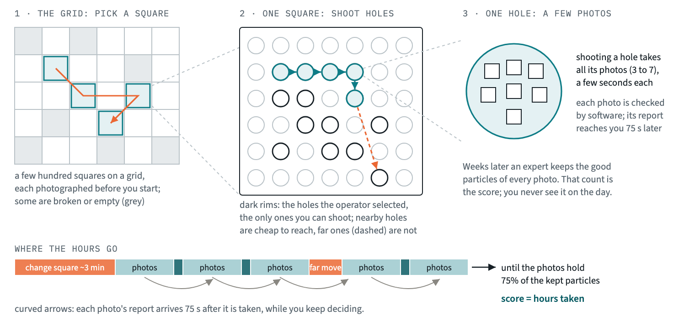
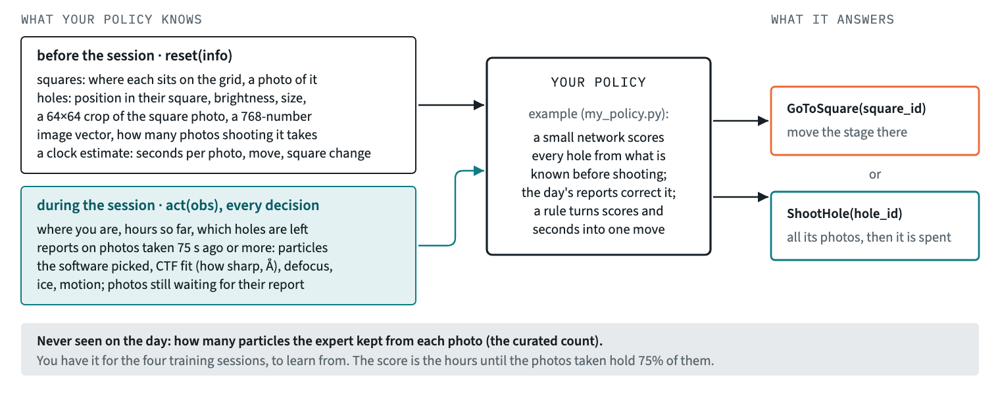

# Where to shoot next: a cryo-EM acquisition challenge

Thank you for taking this on. It is a small research problem from our work, and there is
no single right answer.

**How we judge.** We value a daring or thoughtful idea just as much as a strong score. An
unusual attempt that does not beat the starting policy can still be an excellent
submission. After submission, we will schedule a chat with Luca, our CSO, where you'll have
a chance to explain what you did and why, and any thoughts around the challenge or things
to try if you had more time or compute.

**Time.** A few hours, spread over the week as suits you.

## The problem



An electron microscope photographs frozen protein molecules to work out their 3-D
shape. The molecules sit in thin ice inside tiny holes. The holes are arranged in
squares, and a few hundred squares sit on a grid.

Each square is photographed at low zoom before the session starts. Then, one hole at a
time, the microscope takes a few high-zoom photos (micrographs) of the holes an operator
selected.

Some holes are full of good particles and many are not, and the overview barely tells
you which. Software reports on each photo about 75 seconds after it is taken. Weeks
later an expert decides which particles are good enough to keep, and that count is what
the session was for.

The microscope's time is expensive. It goes into photos, moves between holes and moves
between squares. The microscope's software (EPU) parks the stage at a hole and reaches the
holes within a few micrometres of it by image shift, in about a second. Any other hole needs
a stage move of 45 to 75 seconds, sometimes with an autofocus. A square change takes about
two minutes. `DATA.md` has each session's timings.

**Your task:** write a policy that decides, step by step, which square and which hole
come next. The aim is to collect 75% of the particles the expert kept, in as few
instrument hours as possible, on sessions your policy has never seen.

## What goes in, what comes out



Your policy is a Python class with two methods.

* **`reset(info)`** is called once per session. `info` holds what is known before
  shooting: the squares and the holes the operator selected.
* **`act(obs)`** is called at every decision. `obs` holds where you are, the time, which
  holes are left, and the reports that have arrived. It returns
  `GoToSquare(square_id)` or `ShootHole(hole_id)`.

A simulator replays four real recorded sessions in whatever order your policy chooses.
It charges each session's real timings and stops at 75% of the expert's particles.
`DATA.md` lists every field.

## Getting started

The code is in this repository. The data, 40 MB, are on Hugging Face at
[xkronosx/cryoem-challenge-data](https://huggingface.co/datasets/xkronosx/cryoem-challenge-data);
the first cell of the notebook, or `python main.py download`, fetches them.

**On Google Colab** (the free tier is enough):

1. Open [`START_HERE.ipynb` in Colab](https://colab.research.google.com/github/Tetherline-Dev/cryoem-challenge/blob/main/START_HERE.ipynb).
2. Run the first cell. It connects your Google Drive and copies the challenge into a
   `cryoem-challenge` folder there, with the data. Your edits are saved in that folder.
3. Next time, open `cryoem-challenge/START_HERE.ipynb` from your Drive with Google
   Colaboratory: double-click it, or right-click → Open with. Install Colaboratory in your
   Drive apps if you don't have it already.
4. After running the first cell, if the figures do not appear in Colab, refresh the page before continuing.

**Locally:**

```bash
git clone https://github.com/Tetherline-Dev/cryoem-challenge
cd cryoem-challenge
pip install -r requirements.txt
python main.py download
jupyter notebook START_HERE.ipynb
```

The notebook takes about 15 minutes. It shows the data and the simulator, then builds
the neural network policy in `my_policy.py` step by step.

`my_policy.py` is the one file you edit. Change it, replace it, or start over. To check
it, run `python main.py validate`, or use the notebook. It trains on three sessions and
plays the fourth, in turn.

## The score

Grading plays your policy on two sessions you do not have. The reported number is the
**share of the gap closed** between the operator's recorded order (0%) and an oracle
that knows every outcome in advance (100%). Here is where things stand on your four
sessions:

| policy | instrument hours, four sessions | vs operator | gap closed |
|---|---|---|---|
| oracle: knows every outcome | 45.03 h | −19.6% | 100% |
| operator: the order the session was recorded in | 56.02 h | 0.0% | 0% |
| EPU raster: what EPU does on its own, cluster by cluster, blind to quality | 56.46 h | +0.8% | −4% |
| `bayes_policy.py`: a Bayesian model | 61.06 h | +9.0% | −46% |
| raster: nearest hole next, blind to quality and to where the stage is | 64.96 h | +16.0% | −81% |
| `my_policy.py` as you get it: a small neural network | 68.01 h | +21.4% | −109% |
| random: random squares, random holes | 119.32 h | +113.0% | −576% |

On only two sessions, a percent or two is noise. The score starts the conversation; it
does not settle it. (The hours above come from a fresh install of `requirements.txt`; other
library versions can move the policies' hours by a little.)

Grading presents each hidden session as a real day would: the rows of every table in no
particular order and every id re-issued. `validate` presents the session it plays the same
way; the training sessions keep their recorded order. Positions, images and EPU's settings
are as on your four sessions.

## Handing in

```bash
python main.py submit       # or the last cell of the notebook
```

This trains `my_policy.py` on all four sessions, checks it, and writes `submission.zip`.
The zip also holds anything you added to the folder, such as helper modules or weights.
Send us the zip, then we talk.

| Limit | Value |
|---|---|
| Submission size | 1 GB |
| CPU time per hidden session | 15 minutes, for sessions of up to ~4,000 holes |
| Network during grading | none, so put any pretrained weights in the folder |
| Extra pip packages | list them in `extra_requirements.txt`, with versions |

## Rules

* **Methods.** Use any method you like. Pretrained models, public data, fine-tuning and
  AI assistants are all welcome; we will ask you about your choices.
* **Source data.** Do not download more data from the EMPIAR entries these sessions
  come from (11895, 12124, 13296).
* **Confidentiality.** The data are shared for this challenge only. Do not
  redistribute them, and delete them when you are done.
* **The harness.** Do not edit `challenge/`; grading uses its own copy.
* **Questions.** If something is unclear or broken, ask us. Asking never counts against
  you.
